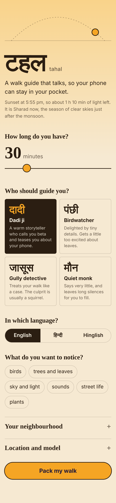
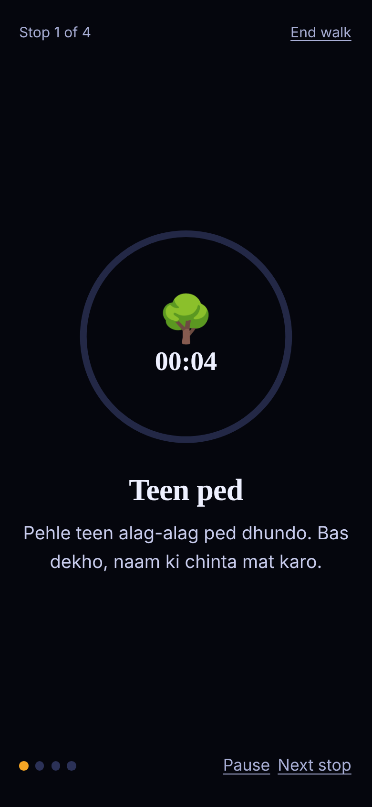

# Tahal (टहल) 🌿

**A walk guide that talks, so your phone can stay in your pocket.**

*Tahal* is Hindi for "a stroll". You tell it how long you have, pick a guide (Dadi ji, a bird-nerd, a gully detective or a quiet monk) and a language (English, हिन्दी or Hinglish). An open **Gemma** model running on your own machine writes a short walk. Then you put the phone away and the walk is *spoken* to you, stop by stop, with a chime between stops. The screen goes black and takes a press-and-hold to wake, so it is safe in a pocket.

**Try it without installing anything:** the [live demo](https://abhyudaysharma.github.io/Tahal/) plays three *hand-written* sample walks (English, Hinglish and Hindi) in your browser, with the same voice, timers, pocket mode and journal. It has no model, so writing new walks needs the setup below.

| Pack | Walk | Pocket |
|---|---|---|
|  |  |  |

## What makes it different

- **Voice-first, auto-advancing.** Each stop has its own timer. When it ends, a chime plays and the next stop is spoken. You never touch the screen mid-walk.
- **Pocket-safe resting screen.** After 12 s with no touch the screen goes pure black with one slow-breathing dot. A tap does nothing; a **press-and-hold** wakes it.
- **Your neighbourhood, never invented.** Add places you pass (“Neem wala chaurahaa: crows argue here at 5pm”). If the guide names a place, the prompt only allows names from your list. No hallucinated “Maple Grove Trail”. With no places added, it names none.
- **Hindi, Hinglish and English**, spoken with your device's own text-to-speech voice (`hi-IN` for Hindi, `en-IN` otherwise).
- **Four guides** that are just prompts: edit `PERSONAS` in `server.js` to add your own.
- **The sky is the interface.** The whole app is coloured by the real phase of day where you are (dawn, day, golden hour, dusk, night), computed on-device from your coordinates. The sun on the arc sits where the sun really is. It also names the Indian season (*ritu*) in the prompt: Sharad, Hemant, Varsha…
- **Pack at home, walk offline.** Generated walks are saved on the device. Playing a walk needs no connection and no model.
- **Reflection + walk card.** When you come back, jot one line. The model answers in your guide's voice, and you can download a shareable PNG card of the walk.
- **Small-model guardrails.** The server forces stop minutes to add up to your time budget exactly, strips emoji and markdown out of spoken text, and tolerates JSON wrapped in chatter.

## Run it

No Ollama? The app still opens. With no model it switches to **demo mode** and offers the sample walks instead of crashing. To have Gemma write walks for you:

You need [Node 18+](https://nodejs.org) and [Ollama](https://ollama.com). There is **no `npm install`**: zero dependencies.

```bash
ollama pull gemma3:4b          # or gemma3n:e2b for something lighter
git clone <this repo> && cd tahal
node server.js                 # http://localhost:3000
```

| env var | default | what |
|---|---|---|
| `PORT` | `3000` | web port |
| `OLLAMA_URL` | `http://127.0.0.1:11434` | your model server |
| `MODEL` | `gemma3:4b` | default model; the UI lists everything you've pulled |
| `NO_WEATHER` | unset | `1` = never make any outside network request |
| `HOME_NAME`, `HOME_LAT`, `HOME_LON` | Aligarh | default location until you set yours |

### Using it on a phone

1. Packing a walk needs the phone to reach your laptop's server. On Android + Chrome, the easiest way is USB: `adb reverse tcp:3000 tcp:3000`, then open `http://localhost:3000` on the phone. `localhost` counts as a secure context, so geolocation, screen wake lock and the service worker all work. Over plain `http://<laptop-ip>:3000`, Chrome blocks those, so type your coordinates instead.
2. **Pack the walk while you are still connected**, then walk. Playback needs only the phone: speech, timers and chimes are all browser APIs.
3. Set your phone's screen timeout to something long. Where the Wake Lock API is available, Tahal asks the screen to stay on.
4. For Hindi speech, the phone needs a Hindi text-to-speech voice installed (system settings). If it has none, Tahal shows the text and chimes instead, and tells you so on the preview screen.

### Dev flags

`?fast=1` makes one “minute” last 2 seconds (for demos and tests). `?phase=night` forces a sky theme.

## Why it runs on an open model

- The model, the server and your journal all live on your machine. Your places and your notes are never uploaded.
- It costs nothing to run, so rerolling a walk ten times is free.
- Swap the model from a dropdown. Change the voice by editing a prompt. No provider has to ship a feature first.
- The one optional network call is weather (Open-Meteo), with coordinates rounded to ~1 km and a hard off switch (`NO_WEATHER=1`).

## Tests

```bash
npm test
```

Starts a fake Ollama and checks the sun maths (server and browser builds), phase-of-day, ritu, minute fitting, output cleaning, prompt rules (place whitelist, language, persona), model swapping, the sample walks, error paths and path traversal.

## How it's built

`server.js` (plain Node `http`, no frameworks) · `public/sun.js` (sun and season maths shared by the server and the browser, so the sky works with no server at all) · `public/app.js` (vanilla JS, Web Speech API, Web Audio, Wake Lock, canvas) · `public/style.css` · a tiny service worker. System fonts only, so nothing is fetched from a CDN.

## License

MIT

## Publishing the demo (GitHub Pages)

`.github/workflows/pages.yml` deploys `public/` as a static site. One-time setup: repo **Settings → Pages → Build and deployment → Source: GitHub Actions**, then push to `main`.
